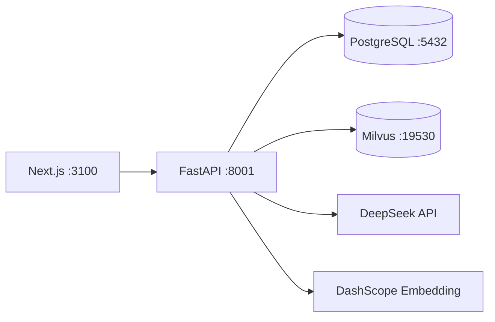

# Steward

Steward 是一个个人 AI 助手：把文档检索、引用溯源、工具调用审批和运行轨迹放进同一个工作台。

前端是 Next.js，后端是 FastAPI + LangGraph，知识库检索用 Milvus 的 dense + BM25 混合检索，模型走 DeepSeek 的 OpenAI 兼容接口。

## 功能

- 邮箱注册 / 登录，JWT 鉴权
- 多会话管理，消息流式输出，可随时停止
- 上传 PDF / DOCX / MD / TXT，自动解析、切块、向量化
- 回答带 `[1]` 引用编号，点击可查看原文
- 内置工具：当前时间、文档检索、保存笔记
- 危险操作先弹审批卡，批准后才执行；支持拒绝
- 每次运行的模型调用、工具参数、耗时、token 都可回放
- 新会话首轮自动带上长期记忆
- 15 道题的检索评测，指标跌超 3 个点直接失败

## 技术栈

| 层 | 选型 |
| --- | --- |
| 后端 | Python 3.12、FastAPI、SQLAlchemy 2.0 async、asyncpg |
| Agent | LangChain 1.x、LangGraph 1.x、AsyncPostgresSaver |
| 数据库 | PostgreSQL 18 |
| 向量库 | Milvus 3.0、pymilvus 3.0 |
| Embedding | DashScope `text-embedding-v4`（1024 维） |
| 模型 | DeepSeek，OpenAI 兼容接口 |
| 前端 | Next.js 16、React 19、Tailwind CSS 4 |
| 日志 | structlog |

## 架构



一次对话的主流程：

```text
前端 POST /api/v1/chat/stream
  → 校验 JWT 与会话归属
  → 用户消息落库
  → Agent 流式推理
  → 需要时调用工具（检索 / 时间 / 笔记）
  → 需要审批时中断，返回审批卡
  → 审批后从 checkpoint 恢复
  → 回答落库、引用回填
  → SSE 逐个事件推给前端
```

后端按 `router → service → repository` 分层：

- `router.py` 只处理 HTTP 入参、状态码和异常翻译
- `service.py` 负责业务判断和事务边界
- `repository.py` 只做数据访问，所有查询都带 `user_id`
- 数据库、Checkpointer、模型、Milvus 都在 `lifespan` 里初始化，模块级不建连接

## 快速开始

### 1. 前置

- Python 3.12、[uv](https://docs.astral.sh/uv/)
- Node.js 22+
- Docker
- DeepSeek API Key
- DashScope API Key

### 2. 配置 `.env`

```bash
cp .env.example .env
```

至少填这几项：

```dotenv
DB_PASSWORD=你的数据库密码
JWT_SECRET=至少32位的随机字符串
DEEPSEEK_API_KEY=sk-...
DASHSCOPE_API_KEY=sk-...
```

完整配置见 [`.env.example`](.env.example)。

### 3. 启动基础设施

`docker-compose.yml` 只包含 PostgreSQL：

```bash
cd Steward
docker compose up -d
```

Milvus 需要单独启动（官方 standalone compose 或已有容器），默认端口 `19530`。Attu 控制台默认占用 `3000`，所以前端用 `3100`。

### 4. 启动后端

```bash
uv sync
uv run uvicorn steward.main:app --reload --port 8001
```

打开 `http://127.0.0.1:8001/docs` 查看接口文档。

> Windows 上建议带 `--reload`。不带时 uvicorn 默认使用 `ProactorEventLoop`，`psycopg` 会报错，Checkpointer 起不来。

### 5. 启动前端

```bash
cd frontend
npm install
npm run dev
```

打开 `http://localhost:3100`。

### 6. 验收

1. 注册账号并登录
2. 新建会话，发一句“你好”，确认回复是流式输出
3. 进入“知识库”，上传一份 PDF 或 MD，等待状态变成“已索引”
4. 回到对话，问文档里的问题，确认回答带引用芯片
5. 说“把这句话保存成笔记”，在审批卡上点“批准并继续”
6. 点回答下方的“轨迹”，查看模型、工具、审批的步骤

## 目录结构

```text
Steward/
├─ src/steward/
│  ├─ main.py              # FastAPI 实例、lifespan、路由挂载
│  ├─ core/                # 配置与日志
│  ├─ common/              # 鉴权依赖、Base、SSE 工具
│  ├─ infra/               # 数据库、Checkpointer、模型、Milvus、Embedding
│  └─ modules/
│     ├─ auth/             # 注册、登录、JWT
│     ├─ thread/           # 会话
│     ├─ chat/             # 消息、SSE、历史
│     ├─ file/             # 聊天附件
│     ├─ tool/             # 工具注册表与内置工具
│     ├─ approval/         # 审批卡
│     ├─ trace/            # 运行轨迹
│     ├─ knowledge/        # 文档解析、切块、检索
│     ├─ memory/           # 长期记忆
│     └─ eval/             # 检索评测
├─ frontend/
│  ├─ app/                 # login / 工作台 / 知识库 / 轨迹页
│  ├─ components/          # 会话栏、消息、审批卡、引用面板等
│  └─ lib/                 # API 封装、SSE 解析、类型
├─ scripts/run_eval.py
├─ tests/eval_cases/rag_v1.jsonl
├─ docker-compose.yml
└─ pyproject.toml
```

## 核心设计

### SSE 事件

`POST /api/v1/chat/stream` 返回 `text/event-stream`，前端按事件名处理：

| 事件 | 作用 |
| --- | --- |
| `message` | 一段回复文本 |
| `additional_info` | 本轮引用来源 |
| `interrupt` | 需要审批的工具调用 |
| `error` | 错误信息 |
| `done` | 本轮结束，带 `run_id` / `message_id` |

### RAG

```text
上传文档
  → 解析（pypdf / python-docx / plain）
  → 按 Markdown 标题切父块（≤3000 字）
  → 父块内切子块（400 字，重叠 60）
  → DashScope embedding
  → 写入 PostgreSQL（父块）和 Milvus（子块）

检索
  → dense + BM25 双路召回
  → RRF 融合
  → 按 parent_id 去重
  → 取前 6 个父块
  → 返回带 ref-xxxxxxxx 编号的引用
```

dense 路有最低相似度 `0.35`；低于阈值的命中直接丢弃，避免“查不到还硬答”。

### 工具与审批

工具在 `tool_registry` 表里注册，`policy` 分三档：

- `auto`：直接执行
- `ask`：中断，等用户批准
- `deny`：模型不可见

`save_note` 默认是 `ask`。中断后后端建一张审批卡，前端点“批准”会调用 `POST /api/v1/approvals/{id}/decide`，后端用 `Command(resume=...)` 从 checkpoint 恢复，继续流式输出。

审批状态用 CAS（`UPDATE ... WHERE status='pending'`）迁移，并发点击只有一个能成功。

### 轨迹

`run_traces` 表记录每次运行的步骤：

- `model`：模型调用、耗时、输入 / 输出 token
- `tool`：工具名、参数、返回值
- `approval`：审批卡
- `error`：失败步骤

前端轨迹页按 `step` 升序展示，输入输出可以展开。

## API

除 `/health` 外都需要 `Authorization: Bearer <token>`。

| 方法 | 路径 | 说明 |
| --- | --- | --- |
| POST | `/api/v1/auth/register` | 注册 |
| POST | `/api/v1/auth/login` | 登录 |
| GET | `/api/v1/auth/me` | 当前用户 |
| GET / POST | `/api/v1/threads` | 会话列表 / 新建 |
| PATCH / DELETE | `/api/v1/threads/{id}` | 改名 / 删除 |
| GET | `/api/v1/threads/{id}/messages` | 历史消息 |
| POST | `/api/v1/files` | 上传聊天附件 |
| POST | `/api/v1/chat/stream` | 流式对话（SSE） |
| GET | `/api/v1/approvals` | 审批列表 |
| POST | `/api/v1/approvals/{id}/decide` | 审批并恢复（SSE） |
| GET | `/api/v1/tools` | 工具列表 |
| PUT | `/api/v1/tools/{name}/policy` | 修改工具策略 |
| GET | `/api/v1/traces/{run_id}` | 轨迹回放 |
| POST / GET | `/api/v1/documents` | 上传 / 列出文档 |
| DELETE | `/api/v1/documents/{id}` | 删除文档 |
| POST | `/api/v1/search` | 混合检索 |
| GET | `/api/v1/memories` | 长期记忆 |
| GET | `/health` | 健康检查 |

## 配置

主要环境变量：

| 变量 | 说明 |
| --- | --- |
| `APP_HOST` / `APP_PORT` | 后端监听地址，默认 `127.0.0.1:8001` |
| `DB_*` | PostgreSQL 连接信息 |
| `JWT_SECRET` | JWT 密钥，至少 32 位 |
| `DEEPSEEK_API_KEY` / `CHAT_MODEL` | 模型配置 |
| `DASHSCOPE_API_KEY` / `EMBEDDING_MODEL` | Embedding 配置 |
| `MILVUS_HOST` / `MILVUS_PORT` | Milvus 地址 |
| `RAG_TOP_K` / `RAG_FINAL_K` / `RAG_MIN_SCORE` | 检索参数 |
| `CORS_ORIGINS` | 允许跨域的前端地址，逗号分隔 |
| `MAX_DOC_TOKENS` | 单文档全文读上限，默认 80000 |

开发时从 `frontend/.env.example` 复制一份 `.env.development`：

```dotenv
NEXT_PUBLIC_API_BASE=http://127.0.0.1:8001
```

`NEXT_PUBLIC_*` 是构建期内联的，改完地址要重新构建。

## 部署

推荐用 nginx 做同域反代：前端 `3100`，后端 `8001`，浏览器只访问一个域名。

```nginx
server {
    listen 443 ssl;
    server_name example.com;

    client_max_body_size 55m;

    location / {
        proxy_pass http://127.0.0.1:3100;
        proxy_set_header Host $host;
    }

    location /api/ {
        proxy_pass http://127.0.0.1:8001;
        proxy_set_header Host $host;

        # SSE 必须关缓冲，否则前端会一次性收到整段
        proxy_buffering off;
        proxy_cache off;
        proxy_read_timeout 300s;
    }
}
```

同域部署时前端 `NEXT_PUBLIC_API_BASE` 留空，请求走 `/api/...`，不需要配 CORS。

前后端分域部署时：

- 前端构建时设 `NEXT_PUBLIC_API_BASE=https://api.example.com`
- 后端 `.env` 设 `CORS_ORIGINS=https://app.example.com`
- 8001 不要直接暴露公网，只让 nginx 访问

其他注意：

- 生产环境 `APP_HOST` 可以改为 `0.0.0.0`，或继续监听 `127.0.0.1` 交给 nginx
- 不要给 Next 加 `output: "export"`，轨迹页是动态路由，静态导出会失败
- `storage/`、PostgreSQL volume、Milvus volume 需要备份
- `.env`、`storage/`、`frontend/.env.development` 不要提交到 Git

## 已知限制

- 没有 pytest 测试集，目前只有 `scripts/run_eval.py` 的检索评测
- `/health` 是静态的，不检查数据库和 Milvus
- 文档入库是同步的，大文件会阻塞上传请求
- 审批卡过期后不会自动清理，前端会置灰
- 工具调用过程没有单独的 SSE 事件，前端暂时看不到“正在调用某工具”的芯片
- 引用后置校验未实现，模型可能写出不存在的引用编号
- `RAG_TOP_K` / `RAG_FINAL_K` 目前没有接进 `search_docs` 的默认参数，实际使用 `20 / 6`

## 说明

这是一个个人项目，主要用于学习和验证“可观测的 AI 助手”这条链路。如果要在生产环境使用，建议先补测试、限流、备份和更细的权限控制。
